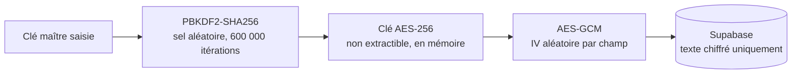

# SecureVault

Gestionnaire de mots de passe web à **chiffrement de bout en bout** : tout est chiffré dans le navigateur avant d'être envoyé au serveur, qui ne reçoit jamais la clé permettant de lire vos données.

**Démo : [my-secure-vault.vercel.app](https://my-secure-vault.vercel.app)**

<!-- Ajouter ici une capture d'écran :  -->

Projet personnel, conçu et développé seul pour comprendre la cryptographie appliquée au web : dérivation de clé, chiffrement authentifié, gestion des secrets en mémoire, politique de sécurité du navigateur, architecture client / backend-as-a-service.

## Fonctionnalités

- Création de compte et connexion par e-mail (Supabase Auth)
- **Clé maître** distincte du mot de passe du compte, jamais envoyée au serveur ni stockée dans le navigateur
- **Tout est chiffré** : mot de passe, nom du site, identifiant et URL
- Ajout, affichage, copie et suppression d'éléments, avec déchiffrement à la demande
- **Verrouillage automatique** après 5 minutes d'inactivité, verrouillage manuel, suppression complète du compte
- **Presse-papiers vidé automatiquement** 30 secondes après une copie
- Migration automatique des anciens comptes vers le format de chiffrement actuel

## Stack

| Rôle | Technologie |
| --- | --- |
| Framework | Next.js 16 (App Router), React 19, TypeScript |
| Interface | Tailwind CSS 4, lucide-react, sonner |
| Backend | Supabase (PostgreSQL, Auth, Row Level Security) |
| Cryptographie | Web Crypto API (natif navigateur, aucune bibliothèque) |
| Tests | Vitest |
| Déploiement | Vercel |

## Modèle de sécurité



- **Dérivation de clé** : PBKDF2-HMAC-SHA256, sel aléatoire de 128 bits, 600 000 itérations (recommandation OWASP).
- **Chiffrement** : AES-256-GCM, un IV aléatoire de 96 bits par champ. GCM est *authentifié* : toute modification des données chiffrées est détectée.
- **Clé non extractible, uniquement en mémoire** : la clé dérivée est un `CryptoKey` que le code JavaScript peut utiliser mais pas relire, et elle n'est écrite ni dans `localStorage` ni dans `sessionStorage`.
- **Vérification de la clé sans la stocker** : un « verifier » (une phrase connue chiffrée avec la clé dérivée) permet de savoir si la clé saisie est correcte. Il contient aussi le sel et le nombre d'itérations.
- **Row Level Security** : les règles de [`docs/supabase-schema.sql`](docs/supabase-schema.sql) limitent chaque utilisateur à ses propres lignes.
- **En-têtes de sécurité** : Content Security Policy (le navigateur ne peut contacter que ce site et Supabase), `X-Frame-Options`, `nosniff`, `Referrer-Policy`, `Permissions-Policy`.

Ce que le serveur voit : l'adresse e-mail du compte, des textes chiffrés illisibles, la catégorie et les dates de création. Il ne voit ni les mots de passe, ni les noms de sites, ni les identifiants.

Formats stockés :

```text
champ    : v2.<iv>.<chiffré+tag>                       (base64)
verifier : v2k.<itérations>.<sel>.<iv>.<chiffré+tag>   (base64)
```

### Menaces prises en compte

| Scénario | Ce qui protège |
| --- | --- |
| Copie de la base de données | Tout est chiffré ; il faut deviner la clé maître, ralenti par PBKDF2 (600 000 itérations) |
| Données modifiées en base | AES-GCM détecte toute altération |
| Faille XSS | La clé est non extractible ; la CSP empêche d'envoyer des données vers un autre site |
| Poste laissé ouvert | Verrouillage automatique après 5 minutes, clé effacée de la mémoire |
| Mot de passe resté dans le presse-papiers | Vidé après 30 secondes |
| Compte d'un autre utilisateur | Row Level Security côté base |

## Choix de conception

- **Pas de récupération de la clé maître.** C'est inhérent au chiffrement de bout en bout : si le serveur pouvait récupérer la clé, il pourrait lire les données.
- **La solidité face à une attaque hors ligne dépend de la clé maître.** PBKDF2 ralentit chaque essai, mais une phrase de passe longue reste la meilleure défense ; 12 caractères minimum sont exigés à la création.
- **CSP sans nonce.** Les scripts injectés par Next.js imposent `'unsafe-inline'` pour l'instant. La CSP limite surtout les destinations réseau et bloque l'intégration dans un cadre externe.
- **Pas d'audit externe.** Le projet est un travail d'apprentissage soigné, pas un produit audité.

## Pistes d'amélioration

- Changement de clé maître, atomique via une fonction SQL (aujourd'hui, ré-chiffrer plusieurs lignes séparément risquerait de laisser des données dans un état mixte en cas d'interruption)
- Double authentification (TOTP, MFA de Supabase)
- Argon2id (via WebAssembly) à la place de PBKDF2
- CSP à base de nonce, pour retirer `'unsafe-inline'`
- Recherche et catégories dans le coffre

## Installation

Prérequis : Node.js 20+ et un projet Supabase.

```bash
git clone https://github.com/Nacim20/my-secure-vault.git
cd my-secure-vault
npm install
cp .env.example .env.local   # puis renseigner l'URL et la clé anon Supabase
```

Dans Supabase, exécutez `docs/supabase-schema.sql` (SQL Editor) pour créer les tables et les règles RLS, puis :

```bash
npm run dev      # http://localhost:3000
```

La clé `anon` de Supabase est publique par conception : c'est la RLS qui protège les données, pas le secret de cette clé.

## Tests

```bash
npm test          # 22 tests
npm run typecheck
npm run lint
```

Les tests couvrent : aller-retour chiffrement/déchiffrement, IV différent à chaque chiffrement, mauvaise clé, détection d'une donnée modifiée, formats invalides, clé non extractible, chiffrement des champs d'un élément, délais maximum, et lecture de l'ancien format v1.

## Structure

```text
app/                    pages (accueil, connexion, coffre)
components/vault/       formulaire d'ajout, ligne de mot de passe, écran de verrouillage
components/providers/   VaultProvider : état du coffre, clé en mémoire, verrouillage automatique
lib/crypto.ts           dérivation de clé, chiffrement AES-GCM, verifier
lib/vaultItems.ts       chiffrement et déchiffrement des champs d'un élément
lib/migrateLegacy.ts    conversion des anciens mots de passe (CryptoJS) vers le format v2
lib/clipboard.ts        copie avec vidage automatique
next.config.ts          en-têtes de sécurité et CSP
tests/                  tests unitaires
docs/                   schéma SQL et règles RLS
```

## Historique

La version 1 utilisait CryptoJS avec une simple chaîne comme clé (dérivation faible, AES-CBC non authentifié), conservait la clé maître dans `sessionStorage` et ne chiffrait que le mot de passe. La version 2 corrige ces points ; les comptes existants sont migrés automatiquement.
