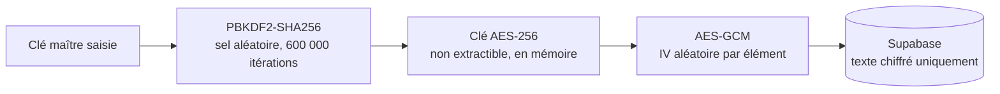

# SecureVault

Gestionnaire de mots de passe web à **chiffrement côté client** : vos mots de passe sont chiffrés dans le navigateur avant d'être envoyés au serveur, qui ne reçoit jamais la clé permettant de les lire.

**Démo : [my-secure-vault.vercel.app](https://my-secure-vault.vercel.app)**

<!-- Ajouter ici une capture d'écran :  -->

Projet personnel, conçu et développé seul pour comprendre la cryptographie appliquée au web : dérivation de clé, chiffrement authentifié, gestion des secrets en mémoire, et architecture client / backend-as-a-service.

## Fonctionnalités

- Création de compte et connexion par e-mail (Supabase Auth)
- **Clé maître** distincte du mot de passe du compte, jamais envoyée au serveur ni stockée dans le navigateur
- Ajout, affichage, copie et suppression de mots de passe
- Déchiffrement à la demande : un mot de passe n'est déchiffré que lorsqu'on l'affiche ou le copie
- Verrouillage manuel du coffre, suppression complète du compte
- Migration automatique des anciens comptes vers le nouveau format de chiffrement

## Stack

| Rôle | Technologie |
| --- | --- |
| Framework | Next.js 16 (App Router), React 19, TypeScript |
| Interface | Tailwind CSS 4, lucide-react, sonner |
| Backend | Supabase (PostgreSQL, Auth, Row Level Security) |
| Cryptographie | Web Crypto API (natif navigateur, aucune bibliothèque) |
| Tests | Vitest |
| Déploiement | Vercel |

## Modèle de sécurité



- **Dérivation de clé** : PBKDF2-HMAC-SHA256, sel aléatoire de 128 bits, 600 000 itérations (recommandation OWASP).
- **Chiffrement** : AES-256-GCM, un IV aléatoire de 96 bits par élément. GCM est *authentifié* : toute modification des données chiffrées est détectée au déchiffrement.
- **Clé non extractible** : la clé dérivée est un `CryptoKey` marqué non extractible. Le code JavaScript peut l'utiliser mais ne peut pas relire sa valeur.
- **Clé uniquement en mémoire** : elle n'est écrite ni dans `localStorage` ni dans `sessionStorage`. Après un rechargement de page, il faut ressaisir la clé maître.
- **Vérification de la clé** : un « verifier » (une phrase connue chiffrée avec la clé dérivée) permet de savoir si la clé saisie est correcte sans la stocker. Il contient aussi le sel et le nombre d'itérations.
- **Row Level Security** : les règles de [`docs/supabase-schema.sql`](docs/supabase-schema.sql) limitent chaque utilisateur à ses propres lignes. Elles doivent être appliquées sur le projet Supabase.

Formats stockés :

```text
élément  : v2.<iv>.<chiffré+tag>                       (base64)
verifier : v2k.<itérations>.<sel>.<iv>.<chiffré+tag>   (base64)
```

## Limites connues

Ce projet n'a pas été audité. À connaître avant de l'utiliser pour de vrais secrets :

- **Seuls les mots de passe sont chiffrés.** Le nom du site, l'identifiant et l'URL sont stockés en clair dans la base.
- **Aucune récupération possible** : si la clé maître est perdue, les données le sont aussi.
- **Pas de changement de clé maître** ni de double authentification pour l'instant.
- **Une faille XSS** permettrait d'utiliser la clé pendant que le coffre est déverrouillé. Il n'y a pas encore de Content Security Policy stricte.
- **Pas de limitation de tentatives** : un attaquant qui a copié la base peut tester des clés maîtres hors ligne. Le coût élevé de PBKDF2 ralentit l'attaque mais ne la remplace pas par une clé maître longue. Une phrase de passe de 12 caractères minimum est exigée à la création.
- Le presse-papiers n'est pas vidé automatiquement après la copie.
- `@supabase/auth-helpers-nextjs` est déprécié : migration vers `@supabase/ssr` prévue.

## Installation

Prérequis : Node.js 20+ et un projet Supabase.

```bash
git clone https://github.com/Nacim20/my-secure-vault.git
cd my-secure-vault
npm install
cp .env.example .env.local   # puis renseigner l'URL et la clé anon Supabase
```

Dans Supabase, exécutez `docs/supabase-schema.sql` (SQL Editor) pour créer les tables et les règles RLS, puis :

```bash
npm run dev      # http://localhost:3000
```

La clé `anon` de Supabase est publique par conception : c'est la RLS qui protège les données, pas le secret de cette clé.

## Tests

```bash
npm test          # chiffrement, verifier, compatibilité avec l'ancien format
npm run typecheck
npm run lint
```

Les tests couvrent : aller-retour chiffrement/déchiffrement, IV différent à chaque chiffrement, mauvaise clé, détection d'une donnée modifiée, formats invalides, clé non extractible, et lecture de l'ancien format v1.

## Structure

```text
app/                    pages (accueil, connexion, coffre)
components/vault/       formulaire d'ajout, ligne de mot de passe, écran de verrouillage
components/providers/   VaultProvider : état du coffre et clé en mémoire
lib/crypto.ts           dérivation de clé, chiffrement AES-GCM, verifier
lib/migrateLegacy.ts    conversion des anciens éléments (CryptoJS) vers le format v2
tests/                  tests unitaires
docs/                   schéma SQL et règles RLS
```

## Historique

La version 1 utilisait CryptoJS avec une simple chaîne comme clé (dérivation faible, AES-CBC non authentifié) et conservait la clé maître dans `sessionStorage`. La version 2 corrige ces points ; les comptes existants sont migrés automatiquement au premier déverrouillage.

## Pistes d'amélioration

- Chiffrer aussi le titre, l'identifiant et l'URL
- Changement de clé maître, double authentification
- Content Security Policy stricte, vidage automatique du presse-papiers
- Verrouillage automatique après inactivité
- Argon2id (via WebAssembly) à la place de PBKDF2
